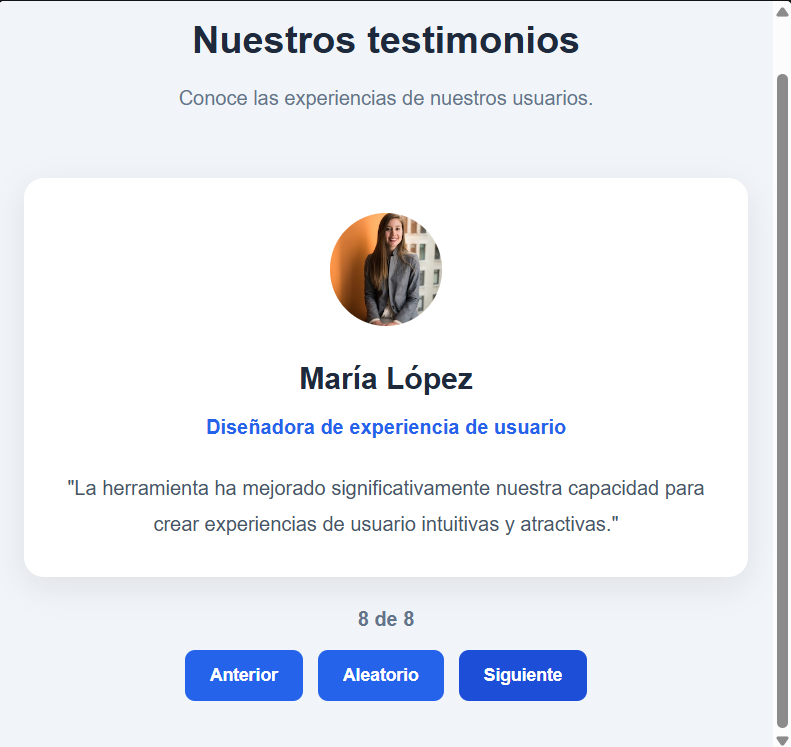
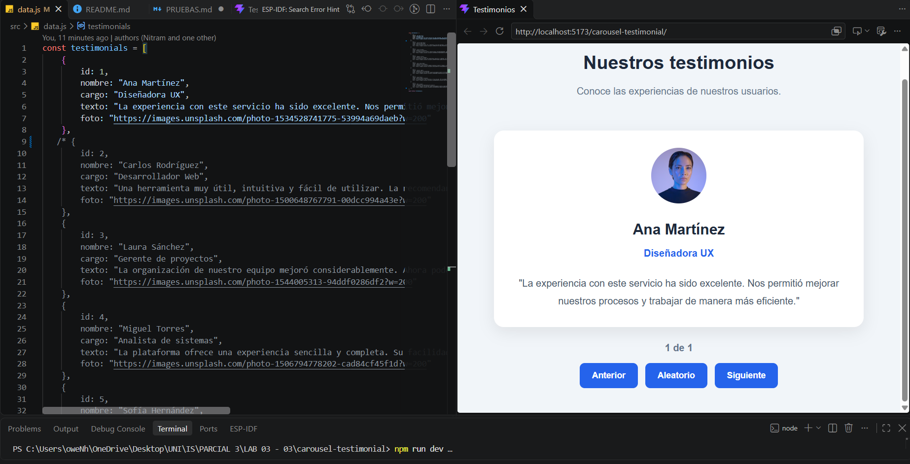
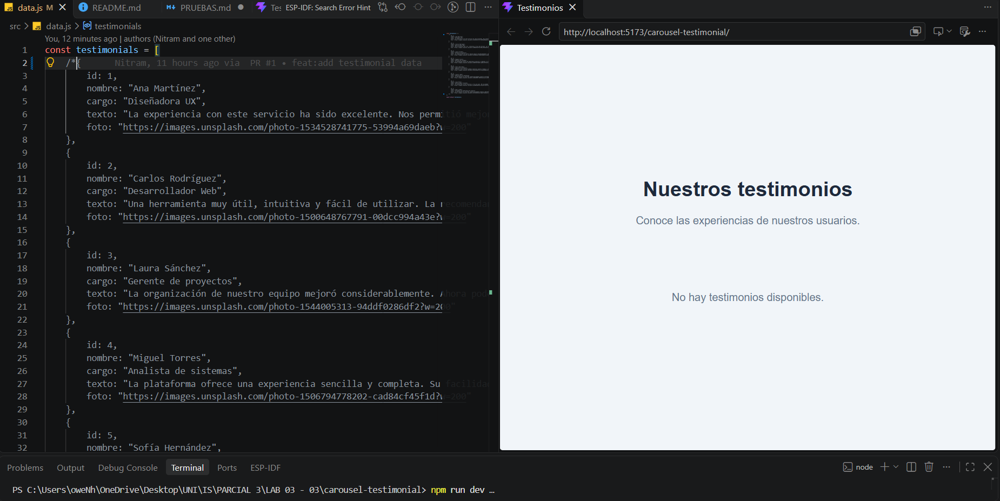
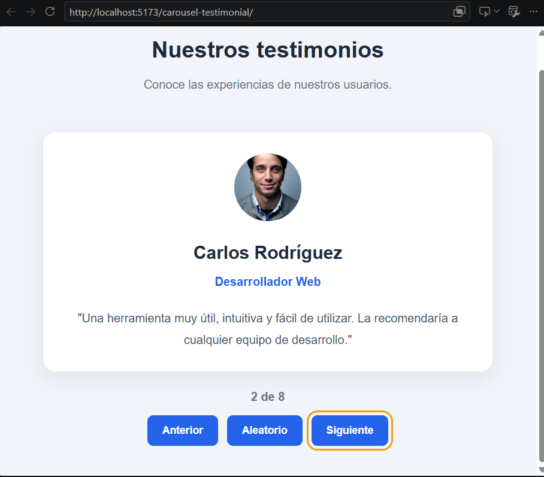
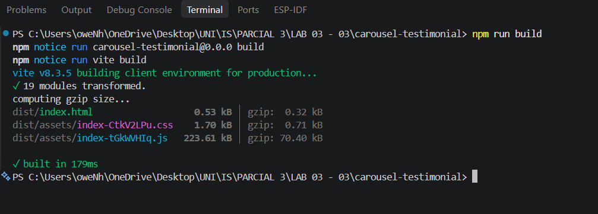
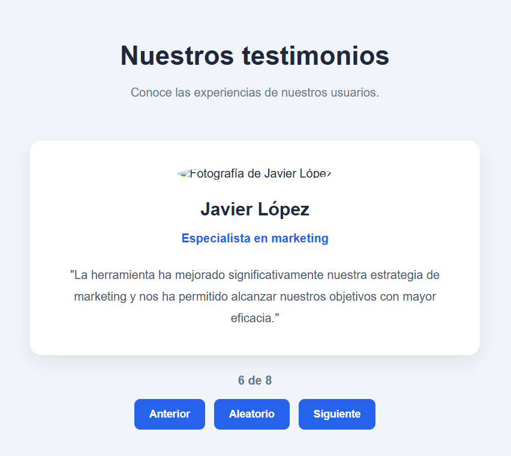
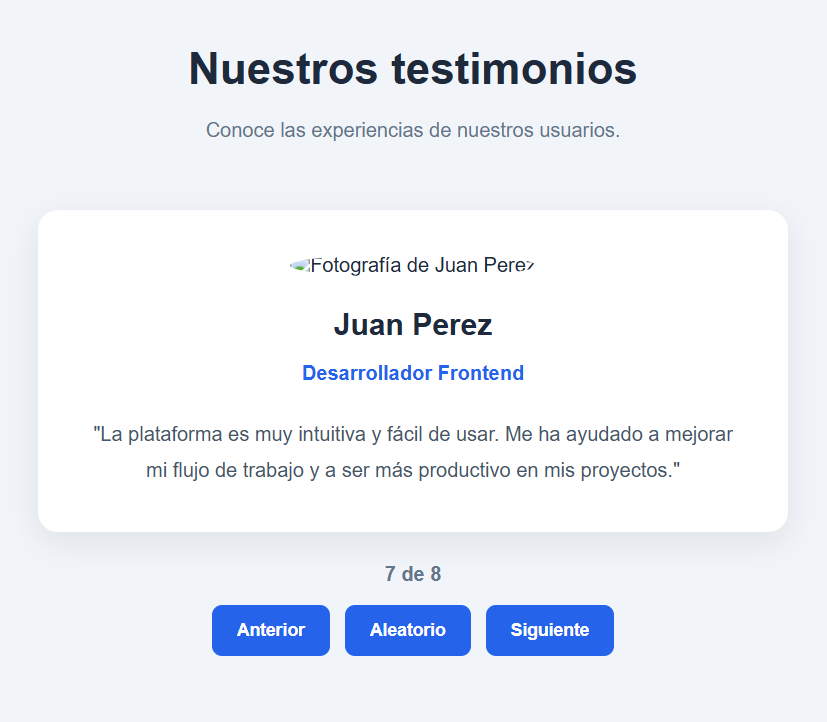

# Pruebas P01 - P10

Práctica inicial de React: aplicación de testimonios.
Etapa evaluada: **etapa básica** (secciones 6 a 10).

- **Integrantes:** Owen Alberto Hdz Naranjillo y Juan Martin Arriaga Alejos
- **Fecha de ejecución:** 04/11/2026
- **Navegadores:** Brave y Opera
- **Sistema operativo:** Windows 11
- **Node.js:** v24.18.0
- **npm:** 12.1.0
- **Datos de prueba:** los 8 testimonios de `src/data.js`

Las pruebas P06 y P07 requirieron modificar temporalmente `src/data.js`; al terminar se restauraron los 8 testimonios originales.

## P01 - Inicio

**Resultado:** La aplicación cargó correctamente con Ana Martínez y el contador en **1 de 8**. No aparecieron errores en consola.

## P02 - Siguiente

**Resultado:** Al presionar **Siguiente** se mostró Carlos Rodríguez y el contador cambió a **2 de 8** correctamente.

## P03 - Límite superior

**Resultado:** Desde el último testimonio, **Siguiente** regresó a Ana Martínez y el contador volvió a **1 de 8**. La navegación circular funcionó sin fallos.

## P04 - Límite inferior

**Resultado:** Se comprobó que al estar en Ana Martínez (1 de 8) y presionar **Anterior**, la aplicación muestra a María López y el contador cambia a **8 de 8**. Se repitió la acción varias veces y el salto siempre fue correcto, sin errores en consola. No se adjunta captura porque el estado visual resultante es equivalente al de P03.

## P05 - Aleatorio

**Resultado:** Se presionó **Aleatorio** 10 veces desde diferentes posiciones. En todos los casos el testimonio cambió a uno distinto del actual, el contador se mantuvo dentro del rango de 1 a 8 y no hubo errores. Al depender del azar, una captura no demuestra por sí sola la propiedad; por eso se verificó repitiendo la acción.

## P06 - Un registro

**Resultado:** Con un solo testimonio, el contador mostró **1 de 1** y los tres controles siguieron funcionando sin errores. Después se restauraron los 8 testimonios.

## P07 - Sin registros

**Resultado:** Con el arreglo vacío apareció el mensaje **"No hay testimonios disponibles."**, no se mostraron tarjeta ni controles y la consola quedó sin errores. Después se restauraron los 8 testimonios.

## P08 - Recorrido completo

**Resultado:** Se recorrieron los 8 testimonios con **Siguiente** y **Anterior**. El contador pasó de **1 de 8** a **8 de 8**, volvió a Ana Martínez y todas las fotografías cargaron correctamente, incluidas las de Javier López y Juan Perez.

## P09 - Presentación y accesibilidad

**Resultado:** Se revisó la interfaz en 320, 768 y 1280 px; no apareció desplazamiento horizontal y los textos largos se ajustaron. Con **Tab** se recorrieron los botones, con **Enter** y **Espacio** se activaron, y el foco se mantuvo visible. Las capturas de los tres tamaños están en el README; esta prueba se complementó manualmente porque el teclado y el foco no se pueden demostrar con una sola imagen congelada.

## P10 - Compilación

**Resultado:** `npm run build` terminó sin errores y la consola del navegador no mostró errores de aplicación. `npm run lint` también terminó sin errores.

## Correcciones y revisiones

### Corrección 1 - Fotografías no visibles

Al revisar los 8 testimonios, las fotografías de Javier López (id 6) y Juan Perez (id 7) no se mostraban y solo aparecía el texto alternativo. Las URLs configuradas en `src/data.js` devolvían error 404. Se reemplazaron por URLs válidas de Unsplash y se verificó que las 8 fotografías cargan correctamente.

### Otras correcciones aplicadas durante el desarrollo

- Se agregaron los testimonios con id 6, 7 y 8 para completar los ocho registros.
- Se cambió la fotografía duplicada del testimonio id 8.
- Se agregó `aria-live="polite"` al contador.
- Se agregó `type="button"` a los botones.
- Se cambió `lang="en"` a `lang="es"` y el título a "Testimonios".
- Se actualizó `main` con los cambios de `develop`.
