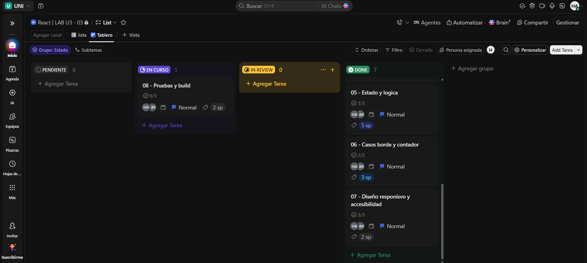

# Nota:
- deploy: [Testimonios LAB 03 - 03](https://nitram047.github.io/carousel-testimonial/)
- El historial de trabajo se puede ver en la rama `develop`.
- En la carpeta `docs/capturas/` contiene las evidencias visuales incluyendo las del tablero pero tambien vienen incluidas en este readme.
- El archivo de PRUEBAS.md contiene el punto 10 con las pruebas de la etapa básica.
---

# Carousel de Testimonios

LAB 03 - 03, aplicación de testimonios utilizando React y Vite. 

La interfaz muestra un testimonio a la vez con fotografía, nombre, cargo y comentario. Permite navegar por medio de los botones **Anterior**, **Siguiente** y **Aleatorio**, conectando los extremos del arreglo. Incluye contador de posición, mensaje cuando no hay registros y diseño responsivo.

## Integrantes
- Owen Alberto Hdz Naranjillo
- Juan Martin Arriaga Alejos 


## Etapa entregada

Se entrega la etapa básica que va de los puntos 6 a 10 deacuerdo al PDF de guía. 

## Tecnologías y versiones

| Herramienta | Versión |
|---|---|
| Node.js | v24.18.0 |
| npm | 12.1.0 |
| React | ^19.3.1 |
| React DOM | ^19.3.1 |
| Vite | ^8.3.5 |
| ESLint | ^10.13.0 |


## Estructura del proyecto

```text
carousel-testimonial/
├── docs/
│   └── capturas/          Capturas de pantalla para la entrega
│       ├── movil-320.jpeg
│       ├── tablet-768.png
│       └── escritorio-1280.png
├── public/
│   ├── favicon.svg
│   └── icons.svg
├── src/
│   ├── assets/
│   │   ├── hero.png
│   │   └── vite.svg
│   ├── components/
│   │   ├── control.jsx    Componente Controls (botones y callbacks)
│   │   └── testimonial.jsx Componente Testimonial (tarjeta)
│   ├── App.jsx            Estado del índice y coordinación
│   ├── data.js            Arreglo de los 8 testimonios
│   ├── main.jsx           Montaje de React en #root
│   └── style.css          Estilos y diseño adaptable
├── index.html
├── package.json
├── package-lock.json
├── PRUEBAS.md             Registro de pruebas P01 a P10
├── vite.config.js
└── eslint.config.js
```

## Decisiones principales

- **Datos separados:** los testimonios viven en `src/data.js`; agregar o modificar registros no requiere tocar la tarjeta ni los controles.
- **Estado centralizado en `App`:** `App` conserva el índice actual con `useState` y calcula el testimonio visible.
- **Presentación reutilizable:** `Testimonial` recibe un `item` por props y solo presenta sus campos; no conoce el arreglo ni cambia el estado.
- **Controles desacoplados:** `Controls` recibe las funciones `onPrev`, `onNext` y `onRandom` por props y comunica la intención al padre.
- **Navegación circular:** se usa el operador `%` para que los extremos se conecten sin acceder a índices fuera del arreglo.
- **Aleatorio válido:** con dos o más testimonios se elige un índice distinto del actual.
- **Casos límite:** con cero registros se muestra un mensaje y no se renderizan tarjeta ni controles; con un registro la interfaz sigue funcionando.
- **Accesibilidad básica:** botones con texto visible, `type="button"`, contador con `aria-live="polite"`, foco visible con `:focus-visible`, imagen con texto alternativo y `lang="es"` en el documento.
- **Diseño adaptable:** anchos revisados en 320, 768 y 1280 px, sin desplazamiento horizontal.
- **Sin autoplay:** se entregó únicamente la etapa básica, por lo que no se usa `useEffect` ni hay botón Pausar/Reanudar.

## Capturas

### Móvil (320 px)


### Tablet (768 px)


### Escritorio (1280 px)


## Tareas y tablero scrum

| Tarea | Responsable | Estado | Fecha | Puntos de historia |
|---|---|---|---|---|
| Preparar entorno con Vite | Martin | Terminado | 2026-11-04 | 2 |
| Crear datos de testimonios | Martin | Terminado | 2026-11-04 | 1 |
| Implementar tarjeta Testimonial | Owen | Terminado | 2026-11-04 | 2 |
| Implementar controles de navegación | Owen | Terminado | 2026-11-04 | 2 |
| Implementar estado y lógica en App | Martin | Terminado | 2026-11-04 | 5 |
| Aplicar estilos y accesibilidad | Martin y Owen  | Terminado | 2026-11-04 | 3 |
| Verificar con pruebas P01 a P10 | Owen | Terminado | 2026-11-04 | 2 |



## Revisión hecha por la otra pareja
### Miembros:
- Martinez Flroes Javier Alexander
- Hernandez Lopez Clara Paulina

### Lo que funciona 
- Los componentes están bien separados: data.js tiene los datos, Testimonial muestra la tarjeta y Controls avisa con callbacks.
- App guarda el índice con useState; Anterior, Siguiente y Aleatorio funcionan, y los extremos se conectan.
- Aleatorio no repite el testimonio actual.
- Se ve bien en móvil y escritorio, sin desplazamiento horizontal, y el foco es visible con Tab.
- npm run build sin errores.

### Sugerencias
- Usar `min-height: 44px` en los botones para que sean más cómodos en el celular.

