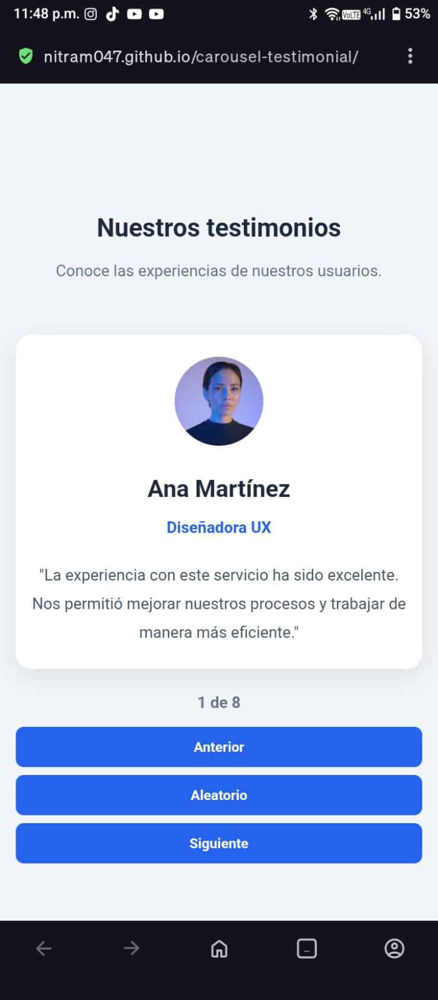
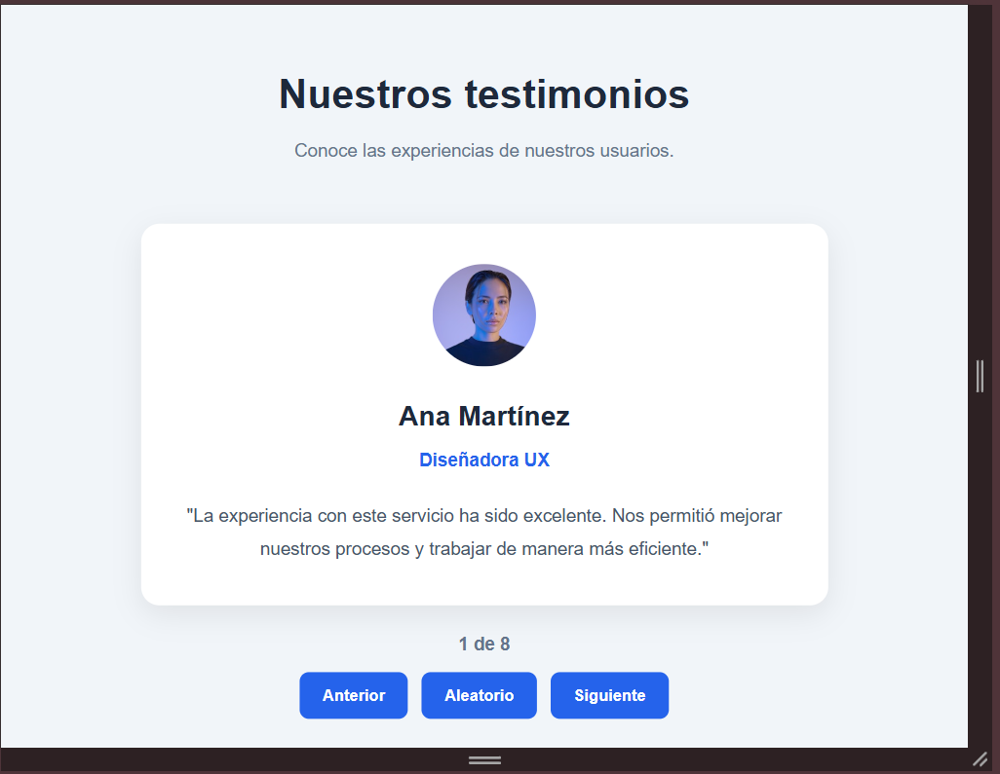
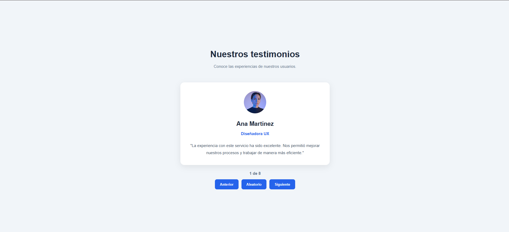

# Carousel de Testimonios

Aplicación de testimonios con React y Vite. Práctica inicial de React de la Unidad 3 de Ingeniería de Software (TecNM Celaya, periodo AGO-DIC 2026).

La interfaz muestra un testimonio a la vez con fotografía, nombre, cargo y comentario. Permite navegar con **Anterior**, **Siguiente** y **Aleatorio**, conectando los extremos del arreglo. Incluye contador de posición, mensaje cuando no hay registros y diseño adaptable a móvil y escritorio.

## Integrantes

| Nombre | Matrícula | Rol en el equipo |
|---|---|---|
| Owen Alberto Hdz Naranjillo | Pendiente | Documentación, pruebas y accesibilidad |
| Juan Martin Arriaga Alejos | Pendiente | Desarrollo de componentes, estado y estilos |

**Fecha de entrega:** 04/11/2026

## Etapa entregada

**Etapa básica (secciones 6 a 10 de la guía).** No se incluye la ampliación de reproducción automática (sección 11). Las pruebas manuales P01 a P10 se registran en [PRUEBAS.md](./PRUEBAS.md).

## Tecnologías y versiones

| Herramienta | Versión |
|---|---|
| Node.js | v24.18.0 |
| npm | 12.1.0 |
| React | ^19.3.1 |
| React DOM | ^19.3.1 |
| Vite | ^8.3.5 |
| ESLint | ^10.13.0 |

## Requisitos

- Node.js LTS (se probó con v24.18.0).
- npm.
- Navegador moderno con herramientas de desarrollo.

## Instalación

```bash
git clone https://github.com/Nitram047/carousel-testimonial.git
cd carousel-testimonial
npm install
```

## Ejecución

```bash
npm run dev
```

Abrir la dirección local que muestra la terminal. Debido a la configuración de `base` para GitHub Pages, la ruta es:

```text
http://localhost:5173/carousel-testimonial/
```

Detener el servidor con `Ctrl+C`.

Comandos disponibles:

| Comando | Resultado |
|---|---|
| `npm run dev` | Servidor de desarrollo con recarga en caliente. |
| `npm run build` | Genera la versión de producción en `dist`. |
| `npm run preview` | Sirve localmente la compilación de `dist`. |
| `npm run lint` | Revisa el código con ESLint. |

Para revisar la versión compilada:

```bash
npm run build
npm run preview
```

## Estructura del proyecto

```text
carousel-testimonial/
├── docs/
│   └── capturas/          Capturas de pantalla para la entrega
│       ├── movil-320.jpeg
│       ├── tablet-768.png
│       └── escritorio-1280.png
├── public/
│   ├── favicon.svg
│   └── icons.svg
├── src/
│   ├── assets/
│   │   ├── hero.png
│   │   └── vite.svg
│   ├── components/
│   │   ├── control.jsx    Componente Controls (botones y callbacks)
│   │   └── testimonial.jsx Componente Testimonial (tarjeta)
│   ├── App.jsx            Estado del índice y coordinación
│   ├── data.js            Arreglo de los 8 testimonios
│   ├── main.jsx           Montaje de React en #root
│   └── style.css          Estilos y diseño adaptable
├── index.html
├── package.json
├── package-lock.json
├── PRUEBAS.md             Registro de pruebas P01 a P10
├── vite.config.js
└── eslint.config.js
```

## Decisiones principales

- **Datos separados:** los testimonios viven en `src/data.js`; agregar o modificar registros no requiere tocar la tarjeta ni los controles.
- **Estado centralizado en `App`:** `App` conserva el índice actual con `useState` y calcula el testimonio visible.
- **Presentación reutilizable:** `Testimonial` recibe un `item` por props y solo presenta sus campos; no conoce el arreglo ni cambia el estado.
- **Controles desacoplados:** `Controls` recibe las funciones `onPrev`, `onNext` y `onRandom` por props y comunica la intención al padre.
- **Navegación circular:** se usa el operador `%` para que los extremos se conecten sin acceder a índices fuera del arreglo.
- **Aleatorio válido:** con dos o más testimonios se elige un índice distinto del actual.
- **Casos límite:** con cero registros se muestra un mensaje y no se renderizan tarjeta ni controles; con un registro la interfaz sigue funcionando.
- **Accesibilidad básica:** botones con texto visible, `type="button"`, contador con `aria-live="polite"`, foco visible con `:focus-visible`, imagen con texto alternativo y `lang="es"` en el documento.
- **Diseño adaptable:** anchos revisados en 320, 768 y 1280 px, sin desplazamiento horizontal.
- **Sin autoplay:** se entregó únicamente la etapa básica, por lo que no se usa `useEffect` ni hay botón Pausar/Reanudar.

## Pruebas

El registro completo está en [PRUEBAS.md](./PRUEBAS.md).

- Pruebas manuales: P01 a P10.
- Compilación: `npm run build` sin errores.
- Linter: `npm run lint` sin errores.
- Revisión visual y por teclado en 320, 768 y 1280 px.

## Capturas

Las imágenes se muestran directamente en GitHub; al hacer clic se abre la versión completa.

### Móvil (320 px)



### Tablet (768 px)



### Escritorio (1280 px)



## Registro de tareas

| Tarea | Responsable | Estado | Fecha | Puntos de historia |
|---|---|---|---|---|
| Preparar entorno con Vite | Juan Martin Arriaga Alejos | Terminado | 2026-11-04 | 2 |
| Crear datos de testimonios | Juan Martin Arriaga Alejos | Terminado | 2026-11-04 | 2 |
| Implementar tarjeta Testimonial | Juan Martin Arriaga Alejos | Terminado | 2026-11-04 | 3 |
| Implementar controles de navegación | Juan Martin Arriaga Alejos | Terminado | 2026-11-04 | 2 |
| Implementar estado y lógica en App | Juan Martin Arriaga Alejos | Terminado | 2026-11-04 | 3 |
| Aplicar estilos y accesibilidad | Juan Martin Arriaga Alejos y Owen Alberto Hdz Naranjillo | Terminado | 2026-11-04 | 3 |
| Verificar con pruebas P01 a P10 | Owen Alberto Hdz Naranjillo y Juan Martin Arriaga Alejos | En proceso | 2026-11-04 | 3 |

## Roles de pareja (conductor y observador)

| Sesión | Conductor | Observador | Fecha |
|---|---|---|---|
| Sesión 1 | Owen Alberto Hdz Naranjillo | Juan Martin Arriaga Alejos | 2026-11-04 |
| Sesión 2 | Juan Martin Arriaga Alejos | Owen Alberto Hdz Naranjillo | 2026-11-04 |

## Revisión por otra pareja

| Campo | Registro |
|---|---|
| Integrantes revisores | Pendiente de asignar |
| Fecha de revisión | Pendiente |
| Componentes y casos revisados | Pendiente |
| Observaciones | Pendiente |
| Correcciones acordadas | Pendiente |

## Notas de entrega

- Repositorio con `package.json`, `package-lock.json` y `.gitignore`; `node_modules` y `dist` no se versionan.
- La rama `main` contiene la versión entregable.
- El trabajo de desarrollo se realizó en la rama `develop`.
- La carpeta `docs/capturas/` contiene las evidencias visuales en los tres tamaños solicitados.
